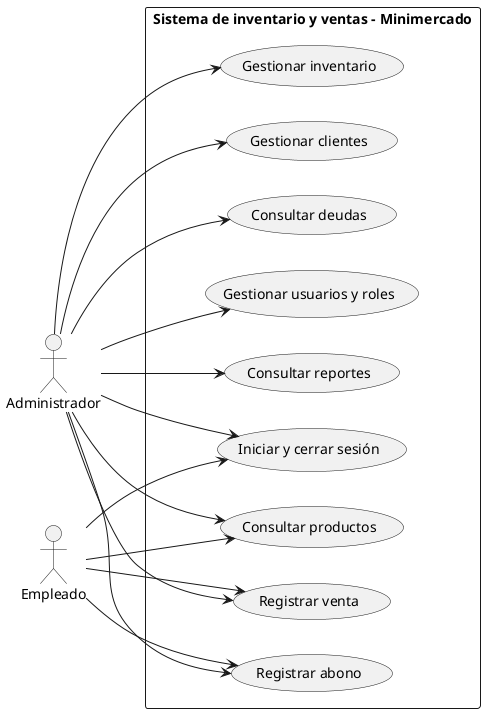
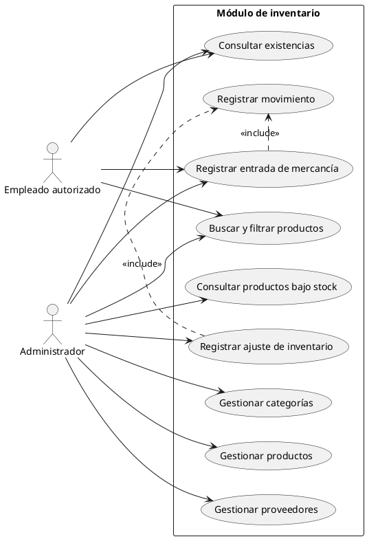
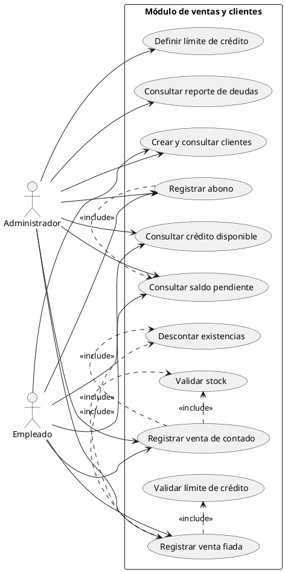
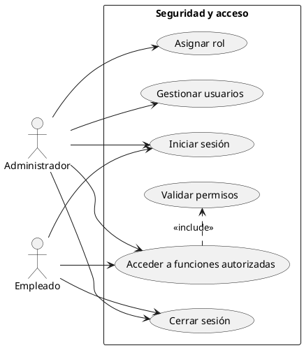
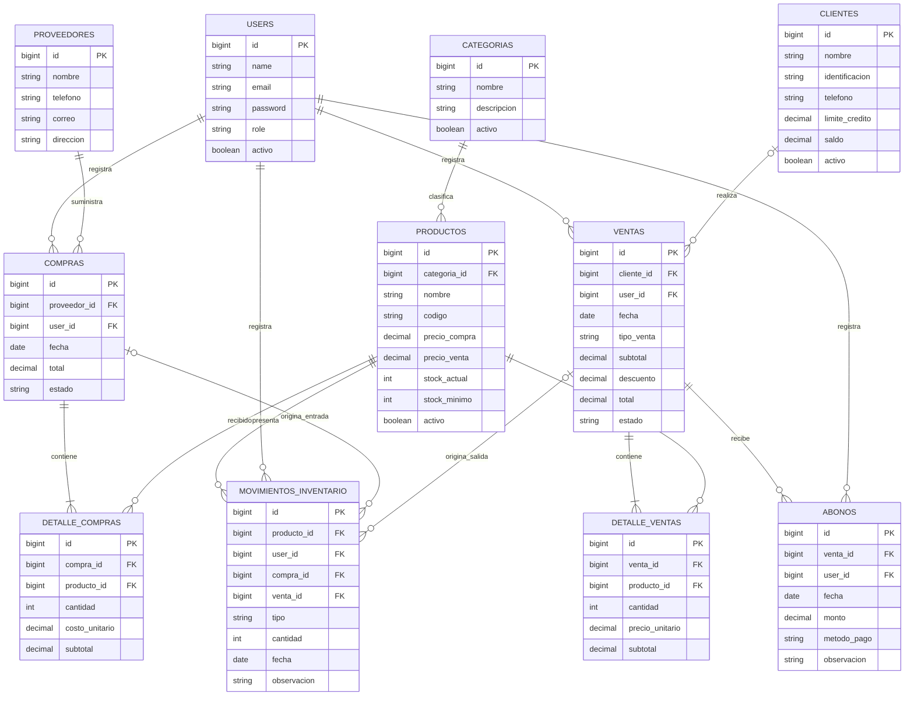

# Sistema de inventario y ventas – Minimercado El Ahorro

**Asignatura:** Desarrollo de Aplicaciones Empresariales  
**Institución:** Unidades Tecnológicas de Santander  
**Integrantes:** Stiven Ariza y Luis Corredor  
**Docente:**  
**Fecha:** Diciembre de 2026  
**Tipo de documento:** Análisis funcional y diseño técnico.

> **Nota sobre el nombre:** se utiliza *Minimercado El Ahorro* como nombre provisional para mantener consistencia en el documento. Antes de la entrega, los integrantes deben confirmar si conservarán este nombre o utilizarán el de un negocio real.

---

## 1. Introducción

El presente proyecto propone el análisis y diseño de un sistema web de inventario y ventas para un minimercado. La solución busca organizar la información de los productos, controlar las entradas y salidas de mercancía y registrar las ventas realizadas en el establecimiento.

El sistema también permitirá administrar clientes que compran a crédito (fiado), registrar sus abonos y consultar los saldos pendientes. El inventario y las ventas serán los procesos principales; la gestión de clientes y la seguridad complementarán su funcionamiento.

Este documento desarrolla la formulación del proyecto, el análisis funcional —qué necesita el negocio y qué debe hacer el sistema— y el diseño técnico —cómo se organizará la solución con Laravel, el patrón MVC y una base de datos relacional—. No describe todavía la implementación del código.

# 2. Formulación del proyecto

## 2.1. Contexto de la empresa

**Nombre propuesto:** Minimercado El Ahorro.

Se plantea como una tienda de barrio ubicada en el área metropolitana de Bucaramanga, atendida por su dueño y un empleado. Comercializa productos de consumo diario, entre ellos víveres, artículos de aseo, bebidas, snacks y productos de la canasta familiar.

Para contextualizar el tamaño del negocio, se estima que maneja entre 300 y 500 referencias de productos y trabaja con aproximadamente 5 a 10 proveedores o distribuidores, quienes entregan mercancía semanalmente o cada quince días.

Actualmente, el control de existencias se realiza de manera visual, los pedidos se hacen según lo que parece faltar en las estanterías y las ventas fiadas se anotan en un cuaderno con el nombre del cliente, la fecha y el valor.

## 2.2. Problemática identificada

El minimercado no cuenta con un registro centralizado que permita conocer con precisión cuánto inventario tiene, cuánto vende y cuánto dinero le deben sus clientes. Esta situación puede ocasionar pérdidas y dificulta la organización de las actividades diarias.

| Problema | Consecuencia |
|---|---|
| No existe un registro actualizado de existencias por producto. | Se agotan productos de alta rotación y se pueden perder ventas. |
| Los pedidos a proveedores se realizan de manera visual. | Se puede comprar mercancía de más o pedir cantidades insuficientes. |
| Las ventas no quedan registradas de forma organizada. | Es difícil conocer qué productos se venden más y cuánto se vende al día. |
| Las ventas fiadas se anotan en un cuaderno. | Se pueden olvidar deudas y no se conoce con claridad cuánto debe cada cliente. |
| Los empleados pueden tener acceso a operaciones que no les corresponden. | Se pueden modificar precios o eliminar información sin autorización. |

## 2.3. Justificación

El desarrollo de una aplicación web permitirá centralizar la información del minimercado y mejorar el control de sus operaciones. El registro de entradas y ventas ayudará a mantener las existencias actualizadas; el control de crédito permitirá consultar las deudas y verificar el cupo disponible de cada cliente; y la administración de usuarios permitirá limitar las operaciones según sus responsabilidades.

La propuesta puede desarrollarse con las herramientas estudiadas en la asignatura, como PHP, Laravel, Composer, una base de datos relacional, operaciones CRUD, autenticación y autorización, sin depender de integraciones con sistemas externos.

## 2.4. Objetivo general

Desarrollar un prototipo web en Laravel, bajo el patrón Modelo-Vista-Controlador (MVC), que permita al Minimercado El Ahorro controlar su inventario, registrar ventas de contado y fiadas y gestionar el crédito de sus clientes, mediante autenticación y control de acceso por roles.

## 2.5. Objetivos específicos

1. Identificar las necesidades del minimercado relacionadas con el control de inventario, las ventas y el crédito de los clientes.
2. Definir los actores, permisos, requerimientos funcionales y requerimientos no funcionales del sistema.
3. Diseñar la solución mediante casos de uso, diagramas UML, un diagrama entidad-relación y una propuesta de arquitectura MVC.
4. Definir una estructura de datos para administrar productos, proveedores, compras, ventas, clientes, abonos y movimientos de inventario.
5. Establecer las reglas para registrar ventas, descontar existencias, validar límites de crédito y registrar abonos.
6. Proponer mecanismos de autenticación, autorización, validación y protección de la información.

## 2.6. Alcance y limitaciones

El prototipo estará orientado a un solo local y cubrirá las operaciones principales de inventario, ventas y fiado.

| Incluye | No incluye |
|---|---|
| Productos, categorías y proveedores (CRUD). | Facturación electrónica ante la DIAN. |
| Entradas de mercancía que aumentan el stock. | Pasarelas de pago o pagos en línea. |
| Ajustes de inventario por daño, vencimiento o pérdida. | Administración de varias sedes o bodegas. |
| Ventas de contado y fiadas que descuentan existencias. | Contabilidad, impuestos y nómina. |
| Clientes con límite de crédito y registro de abonos. | Aplicación móvil nativa. |
| Roles de administrador y empleado. | Integración automática con proveedores reales. |
| Reportes de stock bajo, ventas y cartera. | Lectores físicos de códigos de barras. |
| Historial de movimientos de inventario. | Comercio electrónico o ventas por internet. |

---

# 3. Análisis funcional

El análisis funcional describe quién utilizará el sistema, qué operaciones necesita realizar y cuáles son las reglas que deben cumplirse durante los procesos del minimercado.

## 3.1. Actores y roles

El sistema tendrá dos roles de usuario: administrador y empleado. Los permisos se validarán desde el servidor mediante middleware y Policies; no será suficiente con ocultar botones o enlaces en la interfaz.

| Acción | Administrador (dueño) | Empleado |
|---|---:|---:|
| Iniciar y cerrar sesión. | Sí | Sí |
| Consultar y buscar productos. | Sí | Sí |
| Crear y editar productos, incluidos sus precios. | Sí | No |
| Eliminar o desactivar productos, categorías y proveedores. | Sí | No |
| Gestionar categorías y proveedores. | Sí | No |
| Registrar entradas de mercancía. | Sí | Sí |
| Registrar ajustes de inventario. | Sí | Por definir con el compañero y el docente |
| Registrar ventas de contado. | Sí | Sí |
| Registrar ventas fiadas. | Sí | Sí, dentro del límite del cliente |
| Crear clientes. | Sí | Sí |
| Definir o modificar el límite de crédito. | Sí | No |
| Registrar abonos. | Sí | Sí |
| Consultar reportes de ventas y cartera. | Sí | No |
| Gestionar usuarios y roles. | Sí | No |

**Cliente:** no inicia sesión ni utiliza directamente la aplicación. Es una entidad cuyos datos son registrados y consultados por el personal del minimercado.

## 3.2. Requerimientos funcionales

Los requerimientos se distribuyen entre los dos integrantes: Persona A está a cargo del módulo de inventario y Persona B —el usuario— está a cargo de ventas, clientes y seguridad.

| ID | Requerimiento | Módulo | Responsable |
|---|---|---|---|
| RF-01 | Iniciar y cerrar sesión con correo y contraseña. | Seguridad | B |
| RF-02 | Restringir cada función según el rol del usuario. | Seguridad | B |
| RF-03 | Gestionar usuarios y asignarles un rol. | Seguridad | B |
| RF-04 | Crear, consultar, editar y eliminar o desactivar productos. | Inventario | A |
| RF-05 | Crear, consultar, editar y eliminar o desactivar categorías. | Inventario | A |
| RF-06 | Crear, consultar, editar y eliminar o desactivar proveedores. | Inventario | A |
| RF-07 | Buscar y filtrar productos por nombre, código, categoría y stock bajo. | Inventario | A |
| RF-08 | Registrar entradas de mercancía que aumenten el stock. | Inventario | A |
| RF-09 | Registrar ajustes de inventario por daño, vencimiento o pérdida. | Inventario | A |
| RF-10 | Guardar cada cambio de stock en un historial de movimientos. | Inventario | A |
| RF-11 | Mostrar alertas y reportes de productos con stock igual o menor al mínimo. | Inventario | A |
| RF-12 | Crear, consultar y editar clientes. | Clientes | B |
| RF-13 | Definir y consultar un límite de crédito por cliente. | Clientes | B |
| RF-14 | Registrar ventas con uno o varios productos. | Ventas | B |
| RF-15 | Rechazar una venta si algún producto no tiene stock suficiente. | Ventas | B |
| RF-16 | Descontar el stock y registrar el movimiento al confirmar una venta. | Ventas / Inventario | B + A en integración |
| RF-17 | Registrar ventas fiadas que aumenten el saldo pendiente del cliente. | Ventas | B |
| RF-18 | Rechazar una venta fiada si supera el límite de crédito disponible. | Ventas / Clientes | B |
| RF-19 | Registrar abonos que disminuyan el saldo pendiente del cliente. | Clientes | B |
| RF-20 | Generar reportes de ventas por fecha y de clientes con saldo pendiente. | Reportes | B |

## 3.3. Requerimientos no funcionales

| ID | Tipo | Requerimiento |
|---|---|---|
| RNF-01 | Seguridad | Las contraseñas se almacenarán mediante un mecanismo de hash seguro, como bcrypt de Laravel. |
| RNF-02 | Seguridad | Los formularios estarán protegidos contra solicitudes CSRF mediante el mecanismo de Laravel. |
| RNF-03 | Seguridad | Los permisos se verificarán en el servidor; un acceso no autorizado deberá ser rechazado, por ejemplo, con respuesta HTTP 403. |
| RNF-04 | Seguridad | Las credenciales y configuraciones privadas estarán en `.env`; el repositorio incluirá `.env.example` sin secretos. |
| RNF-05 | Integridad | El registro de una venta se realizará en una transacción: se confirma todo o no se confirma ninguna parte. |
| RNF-06 | Validación | Los datos se validarán en el servidor, preferiblemente mediante Form Requests. |
| RNF-07 | Usabilidad | Los mensajes de error serán claros y estarán en español. |
| RNF-08 | Usabilidad | La interfaz deberá poder utilizarse desde computador y celular. |
| RNF-09 | Mantenibilidad | El código se organizará siguiendo MVC y las convenciones de Laravel. |
| RNF-10 | Portabilidad | El proyecto podrá instalarse mediante Composer y prepararse con sus migraciones en el entorno acordado con el docente. |

## 3.4. Reglas del negocio

1. Cada producto tendrá un código único, nombre, categoría y precio de venta.
2. Las cantidades de entradas, ventas, ajustes y abonos deberán ser mayores que cero.
3. Una venta no podrá confirmarse si la cantidad solicitada supera las existencias disponibles.
4. Una venta de contado se considerará pagada al momento de confirmarse.
5. Una venta fiada deberá estar asociada obligatoriamente a un cliente registrado y activo.
6. Antes de registrar una venta fiada, se verificará que el saldo pendiente actual del cliente más el valor de la nueva venta no supere su límite de crédito.
7. Toda venta confirmada, de contado o fiada, descontará las cantidades vendidas del inventario.
8. Los abonos solo podrán registrarse sobre ventas fiadas que tengan saldo pendiente.
9. Un abono deberá ser mayor que cero y no podrá superar el saldo pendiente de la venta seleccionada.
10. El saldo del cliente aumentará con las ventas fiadas y disminuirá con los abonos registrados.
11. El registro de una entrada de mercancía aumentará las existencias de los productos recibidos.
12. Cada cambio de stock generará un movimiento con su tipo, fecha, cantidad, usuario responsable y motivo u operación de origen.
13. Los productos y clientes con operaciones históricas no deberán eliminarse físicamente; se podrán desactivar para impedir nuevas operaciones.
14. Los permisos de cada usuario se verificarán en el servidor antes de ejecutar una operación.

## 3.5. Casos de uso principales

| ID | Caso de uso | Actor | Requerimientos relacionados | Responsable |
|---|---|---|---|---|
| CU-01 | Iniciar y cerrar sesión. | Administrador, Empleado | RF-01 | B |
| CU-02 | Gestionar productos. | Administrador; ambos consultan. | RF-04, RF-07 | A |
| CU-03 | Gestionar categorías y proveedores. | Administrador | RF-05, RF-06 | A |
| CU-04 | Registrar entrada de mercancía. | Administrador, Empleado autorizado | RF-08, RF-10 | A |
| CU-05 | Registrar una venta de contado o fiada. | Administrador, Empleado | RF-14 a RF-18 | B |
| CU-06 | Gestionar clientes y su límite de crédito. | Administrador; empleado crea clientes. | RF-12, RF-13 | B |
| CU-07 | Registrar un abono. | Administrador, Empleado | RF-19 | B |
| CU-08 | Consultar reportes de inventario, ventas y cartera. | Administrador | RF-11, RF-20 | A y B |

### Diagrama 1. Casos de uso generales

### Diagrama 2. Casos de uso de inventario (Persona A)

### Diagrama 3. Casos de uso de ventas, clientes y crédito (Persona B)

### Diagrama 4. Casos de uso de seguridad

## 3.6. Descripción de procesos principales

### CU-05. Registrar venta (flujo principal)

1. El usuario abre la opción **Nueva venta** y busca los productos por nombre o código.
2. Agrega cada producto e indica la cantidad; el sistema calcula los subtotales y el total.
3. Selecciona el tipo de pago: contado o fiado. Si selecciona fiado, debe elegir un cliente.
4. El usuario confirma la venta.
5. El sistema valida las existencias, guarda la venta y sus detalles, descuenta el stock y registra los movimientos de salida en una sola transacción.
6. Si la venta es fiada, el sistema aumenta el saldo pendiente del cliente.

**Flujos alternos:**

- **Stock insuficiente:** el sistema rechaza la venta, indica qué producto no tiene cantidad suficiente y no guarda parcialmente la operación.
- **Límite de crédito superado:** el sistema rechaza la venta fiada e informa el saldo y el cupo disponible del cliente.
- **Usuario sin sesión:** el sistema solicita iniciar sesión antes de continuar.

### CU-04. Registrar entrada de mercancía (flujo principal)

1. El usuario autorizado selecciona el proveedor y los productos recibidos.
2. Ingresa la cantidad recibida y el costo unitario correspondiente.
3. El sistema valida que las cantidades sean mayores que cero.
4. Se registra la compra y el detalle de los productos recibidos.
5. El sistema aumenta el stock y registra un movimiento de tipo entrada con el usuario y la fecha.

### CU-07. Registrar abono (flujo principal)

1. El usuario busca al cliente y consulta sus ventas fiadas pendientes.
2. Selecciona la venta a la que se aplicará el abono.
3. Ingresa el valor recibido y el medio de pago.
4. El sistema valida que el valor sea mayor que cero y no supere el saldo pendiente.
5. Se registra el abono y se disminuye el saldo de la venta y del cliente.

---

# 4. Diseño técnico

## 4.1. Tecnologías propuestas

| Tecnología | Uso dentro del proyecto |
|---|---|
| PHP | Lenguaje de programación. |
| Laravel | Framework para desarrollar la aplicación web. |
| Composer | Administración de dependencias de PHP. |
| Laravel Breeze | Base para la autenticación de usuarios, sujeto a validar compatibilidad con la versión seleccionada. |
| MySQL | Base de datos relacional. |
| Blade | Motor de plantillas para construir las vistas. |
| Eloquent ORM | Gestión de datos y relaciones entre entidades. |
| Middleware y Policies | Protección de rutas y autorización de operaciones. |
| Tailwind CSS | Estilos de la interfaz, de acuerdo con el stack elegido para Breeze. |
| PlantUML y Mermaid | Elaboración de diagramas. |

## 4.2. Arquitectura del sistema

La aplicación utilizará el patrón **Modelo-Vista-Controlador (MVC)** de Laravel. Esta organización separa la presentación, el procesamiento de solicitudes y el acceso a los datos.

- **Modelo (Model):** representa las entidades y permite consultar o modificar la información mediante Eloquent.
- **Vista (View):** presenta formularios, listados y resultados al usuario mediante Blade.
- **Controlador (Controller):** recibe las solicitudes, valida o coordina la operación y devuelve la respuesta correspondiente.
- **Rutas:** definen las direcciones disponibles para cada operación.
- **Middleware:** verifica la autenticación y puede restringir el acceso según el rol.
- **Policies:** comprueban si un usuario puede realizar una acción sobre un recurso determinado.
- **Base de datos:** almacena usuarios, productos, proveedores, compras, clientes, ventas, abonos y movimientos.

Laravel Breeze será la base de autenticación para el inicio y cierre de sesión, previa confirmación de compatibilidad con la versión de Laravel acordada. Los roles **administrador** y **empleado** determinarán qué módulos y operaciones podrá utilizar cada persona.

## 4.3. Diagrama de arquitectura del sistema

**Flujo general:** el usuario realiza una acción desde el navegador. Laravel recibe la solicitud mediante una ruta, verifica la autenticación y los permisos y la dirige al controlador correspondiente. El controlador coordina la operación con los modelos, que consultan o modifican la base de datos. Finalmente, el sistema devuelve una vista con el resultado.

## 4.4. Diseño preliminar de la base de datos

Las migraciones y relaciones se definirán y revisarán entre los dos integrantes antes de desarrollar los módulos por separado.

| Tabla | Propósito | Campos principales propuestos |
|---|---|---|
| `users` | Cuentas del sistema y rol asignado. | `id`, `name`, `email`, `password`, `role`, `activo` |
| `categorias` | Clasificación de productos. | `id`, `nombre`, `descripcion`, `activo` |
| `proveedores` | Datos de proveedores. | `id`, `nombre`, `telefono`, `correo`, `direccion` |
| `productos` | Catálogo y existencias. | `id`, `categoria_id`, `nombre`, `codigo`, `precio_compra`, `precio_venta`, `stock_actual`, `stock_minimo`, `activo` |
| `compras` | Registro de recepción de mercancía de un proveedor. | `id`, `proveedor_id`, `user_id`, `fecha`, `total`, `estado` |
| `detalle_compras` | Productos recibidos en cada compra. | `id`, `compra_id`, `producto_id`, `cantidad`, `costo_unitario`, `subtotal` |
| `clientes` | Datos del cliente y control de crédito. | `id`, `nombre`, `identificacion`, `telefono`, `correo`, `direccion`, `limite_credito`, `saldo`, `activo` |
| `ventas` | Encabezado de ventas de contado o fiadas. | `id`, `cliente_id`, `user_id`, `fecha`, `tipo_venta`, `subtotal`, `descuento`, `total`, `estado` |
| `detalle_ventas` | Productos incluidos en cada venta. | `id`, `venta_id`, `producto_id`, `cantidad`, `precio_unitario`, `subtotal` |
| `abonos` | Pagos parciales o totales de una venta fiada. | `id`, `venta_id`, `user_id`, `fecha`, `monto`, `metodo_pago`, `observacion` |
| `movimientos_inventario` | Historial de entradas, salidas y ajustes. | `id`, `producto_id`, `user_id`, `compra_id`, `venta_id`, `tipo`, `cantidad`, `fecha`, `observacion` |

**Decisión sobre roles:** como el alcance contempla únicamente dos roles, se propone almacenar el rol como un campo de `users` (`admin` o `empleado`). No se requiere una tabla independiente de roles para este alcance inicial.

**Decisión sobre el saldo:** esta propuesta incluye `clientes.saldo` como saldo acumulado para consultar el crédito disponible. Al confirmar una venta fiada, el saldo aumenta; al registrar un abono, disminuye. Ambas operaciones deben actualizarlo dentro de una transacción. Los saldos deben poder contrastarse con las ventas fiadas y los abonos registrados.

## 4.5. Diagrama entidad-relación

El modelo contempla once tablas principales. Las relaciones opcionales permiten registrar ventas de contado sin identificar al cliente y movimientos de ajuste que no provienen de una compra o venta.

## 4.6. Relaciones principales

- Un usuario puede registrar muchas compras, ventas, abonos y movimientos de inventario.
- Una categoría puede clasificar muchos productos; cada producto pertenece a una categoría.
- Un proveedor puede estar asociado a varias compras.
- Una compra contiene uno o varios detalles y cada detalle corresponde a un producto.
- Un cliente puede tener varias ventas. Una venta de contado puede no tener cliente asociado; una venta fiada sí debe tenerlo.
- Una venta contiene uno o varios detalles y cada detalle corresponde a un producto.
- Una venta fiada puede recibir varios abonos; cada abono corresponde a una venta específica.
- Un producto puede aparecer en muchos detalles de compra y de venta.
- Un producto puede tener muchos movimientos de inventario.
- Un movimiento puede originarse en una compra, una venta o un ajuste manual autorizado.

## 4.7. Decisiones de diseño para la sustentación

- **El stock no se modifica directamente desde el formulario del producto.** Se modifica mediante entradas, ventas o ajustes, para conservar el historial de movimientos.
- **`detalle_ventas.precio_unitario` conserva el precio histórico.** Si el precio del producto cambia posteriormente, las ventas anteriores mantienen el valor al que fueron registradas.
- **`ventas.cliente_id` es opcional para contado.** En ventas fiadas será obligatorio porque la deuda debe asociarse a un cliente.
- **`clientes.saldo` representa el saldo acumulado del cliente.** Aumenta con ventas fiadas y disminuye con abonos. Su actualización debe realizarse junto con el registro de la operación.
- **El rol se almacena en `users`.** Para dos roles fijos (`admin` y `empleado`) no se considera necesaria una tabla de roles y permisos en esta primera versión.
- **Los registros históricos se conservan.** Cuando un producto o cliente ya tiene operaciones relacionadas, se prefiere desactivarlo antes que eliminarlo físicamente.
- **Las ventas se guardan en una transacción.** El encabezado, los detalles, los cambios de stock, los movimientos y el saldo del cliente deben confirmarse juntos cuando corresponda.

---

# 5. División del trabajo

El trabajo se distribuirá entre dos integrantes. Persona A tendrá a cargo inventario; Persona B —el usuario— tendrá a cargo ventas, clientes y seguridad. El análisis, el diseño de datos, la integración y la preparación de la sustentación serán actividades conjuntas.

## 5.1. Persona A: inventario

- CRUD de productos (módulo principal).
- CRUD de categorías y proveedores.
- Registro de entradas de mercancía mediante compras a proveedores, que aumentan el stock.
- Registro de ajustes de inventario por daño, vencimiento o pérdida.
- Alertas y reportes de productos con stock igual o inferior al mínimo.
- Búsqueda y filtros de productos.

## 5.2. Persona B: ventas, clientes y seguridad

- Instalación y configuración del proyecto Laravel y de Laravel Breeze, previa validación de compatibilidad con la versión seleccionada.
- Implementación de inicio y cierre de sesión.
- Gestión de roles `admin` y `empleado` mediante middleware y Policies.
- CRUD de clientes con límite de crédito.
- Módulo de ventas de contado y fiadas.
- Validación de existencias y descuento de stock al confirmar ventas, usando transacciones de base de datos.
- Registro de abonos a ventas fiadas.
- Reporte de clientes con deudas y saldos pendientes.

## 5.3. Actividades conjuntas

- Elaborar el análisis: contexto, problema, objetivos, requerimientos y casos de uso.
- Definir el diagrama entidad-relación y las migraciones antes de separar el desarrollo por módulos.
- Preparar los seeders y los datos iniciales de prueba.
- Revisar e integrar los módulos de ambos integrantes.
- Elaborar el documento final, el README y las evidencias.
- Realizar el ensayo de la sustentación.

---

# 6. Cronograma de trabajo

| Semana | Persona A: inventario | Persona B: ventas, clientes y seguridad | Trabajo conjunto |
|---|---|---|---|
| **Semana 1 (6–12 nov.)** | Redactar contexto, problema y requerimientos de inventario. | Redactar requerimientos de ventas, fiado y seguridad; crear el proyecto Laravel y el repositorio. | Definir casos de uso, diagrama ER, migraciones y seeders. |
| **Semana 2 (13–19 nov.)** | Desarrollar productos, categorías, proveedores y entradas. | Desarrollar roles, clientes, ventas de contado y fiadas, y abonos. | Revisar e integrar los módulos a mitad de semana. |
| **Semana 3 (20–26 nov.)** | Completar reportes y filtros; realizar pruebas de ventas y roles. | Completar reporte de deudas; realizar pruebas de productos. | Preparar documento, README, evidencias y ensayo de sustentación. |

---

# 7. Organización del repositorio y reglas de trabajo

1. Se utilizará un único repositorio en GitHub para el proyecto.
2. Cada integrante trabajará en una rama por módulo, por ejemplo `feature/inventario` y `feature/ventas-seguridad`.
3. Los cambios se integrarán mediante Pull Requests y deberán ser revisados por el otro integrante antes de unirse a la rama principal.
4. Las migraciones y relaciones de la base de datos se definirán conjuntamente antes de desarrollar los módulos por separado.
5. Cada integrante escribirá pruebas para el módulo desarrollado por su compañero: Persona A probará ventas y roles; Persona B probará productos.
6. Se realizarán dos reuniones cortas por semana, de aproximadamente 15 minutos, para revisar avances, bloqueos y tareas siguientes.
7. Antes de la entrega, cada integrante deberá explicar el módulo del otro durante el ensayo de sustentación: Persona A explicará ventas y Persona B explicará productos.

---

# 8. Pendientes por validar

- [ ] Revisar el documento con el compañero y confirmar los requerimientos y responsables.
- [ ] Confirmar con el docente el entorno de ejecución (XAMPP, Laragon u otro) y la versión de Laravel.
- [ ] Verificar la compatibilidad de Laravel Breeze con la versión de Laravel seleccionada.
- [ ] Confirmar las fechas de entrega de cada avance.
- [ ] Confirmar el nombre definitivo del negocio: Minimercado El Ahorro u otro nombre, si se utilizará un establecimiento real.
- [ ] Acordar los campos finales, tipos de datos, claves y restricciones de cada tabla antes de escribir las migraciones.
- [ ] Confirmar cómo se manejará el saldo del cliente y asegurar que ventas fiadas y abonos lo actualicen de forma consistente.
- [ ] Crear el repositorio en GitHub y las ramas por módulo.

# 9. Conclusiones

El análisis funcional permitió identificar las necesidades principales del minimercado y definir las operaciones que deberá cubrir el sistema, especialmente el control de existencias, las ventas de contado y fiadas, y la administración de abonos y deudas.

El diseño técnico propone una aplicación web basada en Laravel y el patrón MVC, con autenticación y autorización por roles y una base de datos relacional que conecta productos, compras, clientes, ventas, abonos y movimientos de inventario.

La división del trabajo permite desarrollar los módulos de inventario y de ventas, clientes y seguridad en paralelo. Sin embargo, el modelo de datos, las migraciones, la integración, las pruebas cruzadas y la sustentación serán responsabilidades compartidas.

---

## Nota sobre el alcance de este documento

Este documento comprende la formulación, el análisis funcional, el diseño técnico y la organización inicial del trabajo. Los diagramas, tablas y reglas representan una propuesta que ambos integrantes deberán revisar y aprobar antes de crear las migraciones definitivas. La implementación, las pruebas ejecutadas y las evidencias reales corresponden a las siguientes etapas del proyecto.
