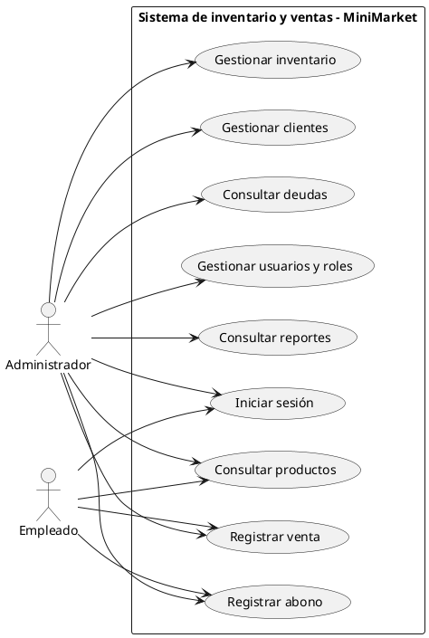
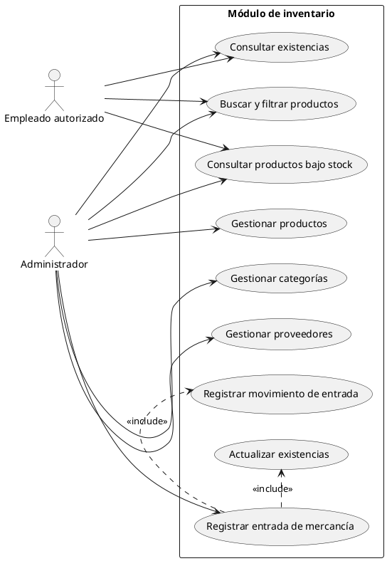
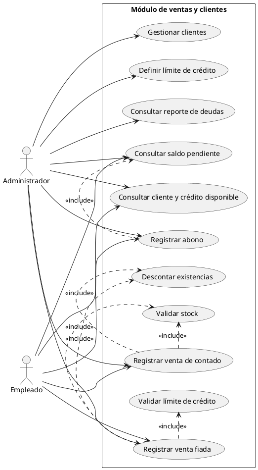
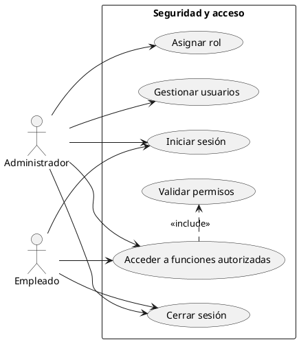
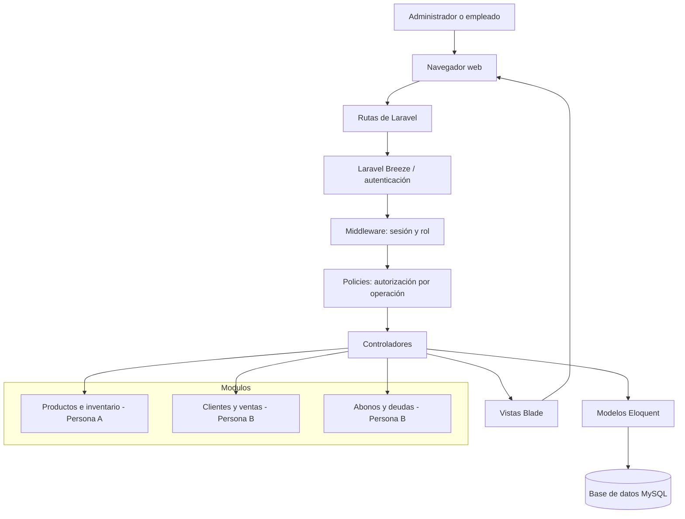
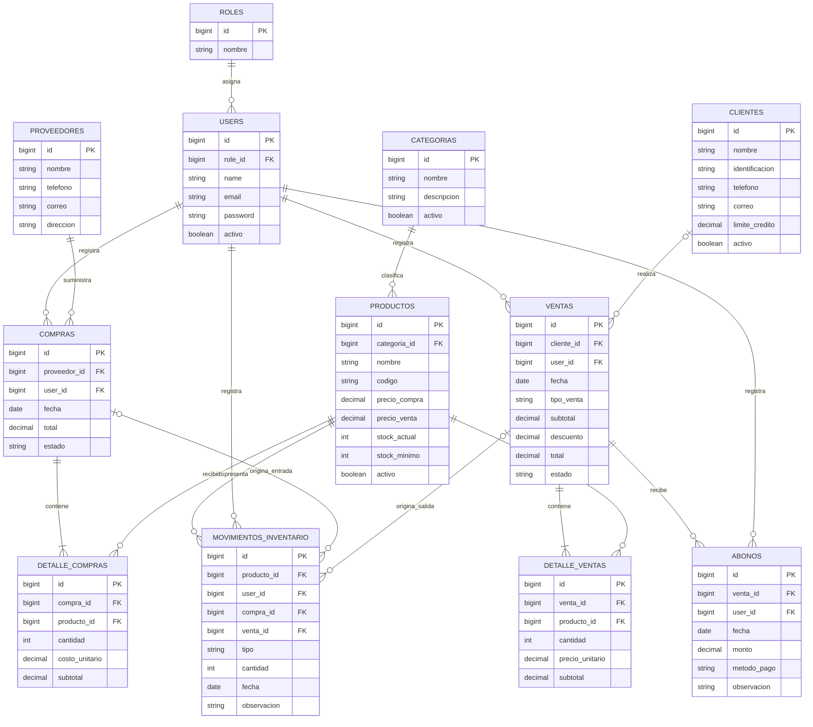

# Proyecto: Sistema de inventario y ventas para un MiniMarket

**Asignatura:** Desarrollo de Aplicaciones Empresariales  
**Institución:** Unidades Tecnológicas de Santander  
**Integrantes:** Stiven Ariza, Luis Corredor. 
**Docente:**  
**Fecha:** 

---

## 1. Introducción

El presente proyecto propone el análisis y diseño de un sistema web de inventario y ventas para un MiniMarket. La aplicación permitirá administrar productos, controlar las existencias, registrar compras a proveedores y gestionar las ventas realizadas en el establecimiento.

El sistema también contemplará el registro de clientes, las ventas a crédito (fiado), los abonos realizados por los clientes y la consulta de las deudas pendientes. De esta manera, el inventario y las ventas serán los procesos principales, mientras que la gestión de clientes y la seguridad permitirán controlar quién realiza cada operación.

La documentación comprende el análisis funcional —qué necesita el negocio y qué debe hacer el sistema— y el diseño técnico —cómo se organizará la solución mediante Laravel, MVC y una base de datos relacional—.

## 2. Descripción del negocio

**Nombre propuesto:** MiniMarket El Ahorro.

MiniMarket El Ahorro es un establecimiento comercial pequeño dedicado a la venta de productos de consumo diario, como alimentos empacados, bebidas, productos de aseo y artículos básicos para el hogar.

El negocio recibe mercancía de diferentes proveedores, almacena los productos para su posterior venta y atiende a clientes durante el día. Necesita conocer las existencias disponibles, registrar las entradas de mercancía y controlar las ventas. Además, algunos clientes pueden realizar compras a crédito y pagar posteriormente mediante abonos.

## 3. Análisis funcional

### 3.1. Problema identificado

El MiniMarket necesita mejorar la forma en que administra sus productos, controla sus existencias y registra sus ventas. Cuando las entradas y salidas de mercancía no se registran de manera organizada, puede ser difícil conocer el stock real y detectar productos agotados o próximos a agotarse.

También se necesita llevar un control de los clientes que compran a crédito, conocer cuánto deben, registrar los abonos y verificar que una nueva compra fiada no supere el límite de crédito autorizado.

Por esta razón, se propone un sistema que centralice la información de inventario, ventas y clientes, y que permita controlar el acceso de acuerdo con el rol de cada usuario.

### 3.2. Objetivo general

Diseñar un sistema web de inventario y ventas para un MiniMarket que permita administrar productos, controlar existencias, registrar ventas de contado y a crédito, gestionar clientes y controlar los abonos pendientes mediante una aplicación desarrollada con Laravel y una base de datos relacional.

### 3.3. Objetivos específicos

1. Identificar las necesidades del MiniMarket relacionadas con el inventario, las ventas y el control de clientes.
2. Definir los usuarios, permisos y funcionalidades principales del sistema.
3. Diseñar una base de datos para organizar productos, proveedores, compras, ventas, clientes, abonos y movimientos de inventario.
4. Proponer una arquitectura basada en el patrón Modelo-Vista-Controlador (MVC).
5. Establecer reglas para mantener actualizadas las existencias y controlar las ventas a crédito.

### 3.4. Alcance del sistema

El sistema estará enfocado en las operaciones principales del MiniMarket e incluirá los siguientes módulos:

- **Productos:** registro, consulta, actualización y desactivación de productos.
- **Categorías:** clasificación de los productos.
- **Proveedores:** registro y consulta de proveedores.
- **Entradas de mercancía:** registro de compras recibidas y aumento de existencias.
- **Inventario:** consulta de stock, búsqueda, filtros y alertas de productos con bajo stock.
- **Clientes:** registro y administración de clientes, incluyendo su límite de crédito.
- **Ventas:** registro de ventas de contado o a crédito, con descuento automático de existencias.
- **Abonos:** registro de pagos parciales o totales de las ventas fiadas.
- **Cuentas por cobrar:** consulta de clientes con deudas y saldos pendientes.
- **Seguridad:** inicio y cierre de sesión y control de acceso para los roles administrador y empleado.

No se contempla desarrollar contabilidad, nómina, facturación electrónica, integración bancaria, ventas por internet ni administración de varias sucursales.

### 3.5. Usuarios del sistema

| Usuario | Responsabilidades principales |
|---|---|
| Administrador | Administrar usuarios, productos, categorías, proveedores y clientes; definir límites de crédito; consultar inventario, ventas y reportes. |
| Empleado | Consultar productos y clientes, registrar ventas de contado o a crédito y registrar abonos, según los permisos asignados. |

Los permisos definitivos se aplicarán desde el servidor mediante middleware y Policies. Ocultar una opción en la interfaz no será suficiente para proteger una operación.

### 3.6. Funcionalidades principales

| Código | Funcionalidad | Descripción |
|---|---|---|
| RF01 | Autenticación | Permitir iniciar y cerrar sesión. |
| RF02 | Roles y permisos | Diferenciar el acceso del administrador y del empleado. |
| RF03 | Gestión de productos | Registrar, consultar, actualizar y desactivar productos. |
| RF04 | Categorías y proveedores | Administrar categorías y proveedores. |
| RF05 | Entradas de mercancía | Registrar compras recibidas y aumentar las existencias. |
| RF06 | Búsqueda y filtros | Buscar productos y filtrar el catálogo. |
| RF07 | Bajo stock | Identificar y consultar productos con stock igual o inferior al mínimo. |
| RF08 | Clientes | Registrar, consultar, actualizar y desactivar clientes. |
| RF09 | Límite de crédito | Asignar y consultar el límite de crédito de cada cliente. |
| RF10 | Ventas de contado | Registrar ventas pagadas al momento. |
| RF11 | Ventas a crédito | Registrar ventas fiadas asociadas a un cliente. |
| RF12 | Descuento de inventario | Descontar las cantidades vendidas del stock disponible. |
| RF13 | Abonos | Registrar pagos parciales o totales de una venta fiada. |
| RF14 | Consulta de deudas | Consultar los clientes que tienen saldos pendientes y el valor adeudado. |
| RF15 | Historial de ventas | Consultar las ventas realizadas. |

### 3.7. Requerimientos no funcionales

- **Seguridad:** el sistema solicitará autenticación y restringirá las operaciones según el rol y los permisos del usuario.
- **Integridad:** una venta no podrá confirmarse si no existe stock suficiente.
- **Consistencia:** el registro de una venta, sus detalles, el descuento de stock y los movimientos asociados deberán completarse como una sola operación.
- **Validación:** los datos ingresados en los formularios deberán validarse antes de guardarse.
- **Usabilidad:** la interfaz deberá ser clara y fácil de utilizar para el administrador y el empleado.
- **Mantenibilidad:** el código deberá organizarse siguiendo la estructura MVC de Laravel.
- **Persistencia:** la información deberá almacenarse en una base de datos relacional.

### 3.8. Reglas del negocio

1. Todo producto debe tener un código único, nombre, categoría y precio de venta.
2. Las cantidades de entrada, venta y abono deben ser mayores que cero.
3. Una venta no puede confirmarse si la cantidad solicitada supera las existencias disponibles.
4. Una venta de contado se considera pagada al momento de confirmarse.
5. Una venta fiada debe estar asociada obligatoriamente a un cliente registrado y activo.
6. Antes de registrar una venta fiada, el sistema debe verificar que la deuda actual del cliente más el valor de la nueva venta no supere su límite de crédito.
7. Al confirmar cualquier venta, sea de contado o fiada, el sistema debe descontar del inventario las cantidades vendidas.
8. Los abonos solo podrán registrarse sobre ventas fiadas que tengan saldo pendiente.
9. El valor de un abono debe ser mayor que cero y no puede superar el saldo pendiente de la venta.
10. La deuda de un cliente se calculará a partir de sus ventas fiadas pendientes, restando los abonos registrados.
11. Al registrar una compra o entrada de mercancía, el sistema debe aumentar las existencias de los productos recibidos.
12. Cada entrada o salida debe generar un movimiento de inventario que permita conocer su origen, fecha, cantidad y usuario responsable.
13. Los productos y clientes con operaciones históricas no deben eliminarse físicamente; podrán desactivarse para impedir nuevas operaciones.
14. Los permisos de cada usuario deben verificarse en el servidor antes de ejecutar una operación.

### 3.9. Procesos principales

#### A. Entrada de mercancía

1. El administrador o empleado autorizado selecciona el proveedor.
2. Registra los productos recibidos y sus cantidades.
3. El sistema valida la información.
4. Se registra la compra y su detalle.
5. Se incrementan las existencias de los productos.
6. Se genera un movimiento de tipo **ENTRADA** por cada producto recibido.

#### B. Venta de contado

1. El empleado busca y selecciona los productos solicitados.
2. Indica las cantidades.
3. El sistema verifica que exista stock suficiente.
4. El sistema calcula el subtotal, descuentos y total.
5. Al confirmar, se registra la venta y su detalle.
6. Se descuentan las cantidades vendidas del inventario.
7. Se genera un movimiento de tipo **SALIDA** por cada producto vendido.

#### C. Venta a crédito (fiado)

1. El empleado busca y selecciona un cliente registrado.
2. Selecciona los productos e indica las cantidades.
3. El sistema verifica las existencias disponibles.
4. El sistema calcula el total de la venta.
5. El sistema consulta la deuda actual y el límite de crédito del cliente.
6. Si el cliente tiene crédito disponible, se registra la venta fiada.
7. Se descuenta el stock y se registra la salida de inventario.
8. El valor de la venta queda como saldo pendiente del cliente.

#### D. Registro de abonos

1. El empleado busca al cliente y consulta sus ventas fiadas pendientes.
2. Selecciona la venta sobre la cual se realizará el abono.
3. Ingresa el valor recibido y el medio de pago.
4. El sistema valida que el abono no supere el saldo pendiente.
5. Se registra el abono y se recalcula el saldo de la venta.

#### E. Consulta de deudas

1. El administrador ingresa al reporte de cuentas por cobrar.
2. El sistema consulta las ventas fiadas que tienen saldo pendiente.
3. Agrupa la información por cliente.
4. Muestra el total adeudado y el saldo pendiente de cada venta.

### 3.10. Casos de uso

Los siguientes diagramas representan las interacciones principales entre los usuarios y el sistema. El **Administrador** cuenta con permisos de administración. El **Empleado** realiza las operaciones de atención y venta que tenga autorizadas.

#### Diagrama 1. Casos de uso generales

#### Diagrama 2. Casos de uso de inventario (responsabilidad de Persona A)

#### Diagrama 3. Casos de uso de ventas, clientes y crédito (responsabilidad de Persona B)

#### Diagrama 4. Casos de uso de seguridad

#### Descripción breve de los casos de uso

| Caso de uso | Actor principal | Resultado esperado |
|---|---|---|
| Registrar entrada | Administrador o empleado autorizado | Se registra la mercancía recibida y aumenta el stock. |
| Gestionar productos | Administrador | Se mantiene actualizado el catálogo. |
| Registrar venta de contado | Administrador o empleado | Se registra la venta y disminuye el stock. |
| Registrar venta fiada | Administrador o empleado | Se registra la deuda del cliente y disminuye el stock. |
| Registrar abono | Administrador o empleado | Se registra el pago y disminuye el saldo pendiente. |
| Consultar deudas | Administrador | Se muestra cuánto debe cada cliente. |
| Gestionar usuarios | Administrador | Se crean usuarios y se asignan roles. |

## 4. Diseño técnico

### 4.1. Tecnologías propuestas

| Tecnología | Uso dentro del proyecto |
|---|---|
| PHP | Lenguaje de programación. |
| Laravel | Framework para desarrollar la aplicación web. |
| Composer | Administración de dependencias de PHP. |
| Laravel Breeze | Base para la autenticación de usuarios. |
| MySQL | Base de datos relacional. |
| Blade | Motor de plantillas para construir las vistas. |
| Eloquent ORM | Gestión de datos y relaciones entre entidades. |
| Middleware y Policies | Protección de rutas y autorización de operaciones. |
| Bootstrap | Apoyo para el diseño de la interfaz. |
| PlantUML y Mermaid | Elaboración de diagramas. |

### 4.2. Arquitectura del sistema

La aplicación utilizará el patrón **Modelo-Vista-Controlador (MVC)** de Laravel. Esta organización separa la presentación, el procesamiento de las solicitudes y el acceso a los datos.

- **Vista (View):** muestra formularios, listados y resultados al usuario mediante Blade.
- **Controlador (Controller):** recibe las solicitudes, coordina la operación y devuelve la respuesta correspondiente.
- **Modelo (Model):** representa las entidades y permite consultar o modificar la información mediante Eloquent.
- **Rutas:** definen las direcciones disponibles para cada operación.
- **Middleware:** verifica que el usuario haya iniciado sesión y que tenga el rol requerido.
- **Policies:** permiten comprobar si un usuario tiene autorización para realizar una acción sobre un recurso.
- **Base de datos:** almacena usuarios, productos, proveedores, compras, clientes, ventas, abonos y movimientos.

Laravel Breeze se utilizará como punto de partida para el inicio y cierre de sesión. Los roles **administrador** y **empleado** determinarán qué módulos y operaciones podrá utilizar cada usuario.

### 4.3. Diagrama de arquitectura

**Flujo general:** el usuario realiza una acción desde el navegador. Laravel recibe la solicitud mediante una ruta, verifica la autenticación y los permisos y la dirige al controlador correspondiente. El controlador coordina la operación con los modelos, que consultan o modifican la base de datos. Finalmente, se devuelve una vista con el resultado.

### 4.4. Diseño de la base de datos

La base de datos se organizará en las siguientes tablas. Las migraciones deberán definirse y revisarse entre los dos integrantes antes de desarrollar los módulos por separado.

| Tabla | Propósito | Campos principales |
|---|---|---|
| roles | Define los perfiles de acceso. | id, nombre |
| users | Almacena las cuentas del sistema. | id, role_id, name, email, password, activo |
| categorias | Clasifica los productos. | id, nombre, descripcion, activo |
| proveedores | Guarda los datos de proveedores. | id, nombre, telefono, correo, direccion |
| productos | Contiene el catálogo y las existencias. | id, categoria_id, nombre, codigo, precio_compra, precio_venta, stock_actual, stock_minimo, activo |
| compras | Registra la recepción de mercancía de un proveedor. | id, proveedor_id, user_id, fecha, total, estado |
| detalle_compras | Detalla los productos recibidos. | id, compra_id, producto_id, cantidad, costo_unitario, subtotal |
| clientes | Guarda los datos de clientes y su límite de crédito. | id, nombre, identificacion, telefono, correo, direccion, limite_credito, activo |
| ventas | Registra ventas de contado o fiadas. | id, cliente_id, user_id, fecha, tipo_venta, subtotal, descuento, total, estado |
| detalle_ventas | Detalla los productos vendidos. | id, venta_id, producto_id, cantidad, precio_unitario, subtotal |
| abonos | Registra pagos realizados sobre ventas fiadas. | id, venta_id, user_id, fecha, monto, metodo_pago, observacion |
| movimientos_inventario | Conserva el historial de entradas y salidas. | id, producto_id, user_id, compra_id, venta_id, tipo, cantidad, fecha, observacion |

**Nota:** `cliente_id` puede quedar vacío en una venta de contado cuando no sea necesario identificar al comprador. En una venta fiada, el cliente será obligatorio. El límite de crédito se almacenará en `clientes`; el saldo pendiente se calculará a partir del total de las ventas fiadas menos sus abonos.

### 4.5. Diagrama entidad-relación

El siguiente modelo muestra las entidades principales y sus relaciones. Las claves primarias se identifican como **PK** y las claves foráneas como **FK**.

### 4.6. Explicación de las relaciones

- Un rol puede estar asignado a varios usuarios, pero cada usuario tiene un rol.
- Una categoría puede clasificar muchos productos.
- Un proveedor puede estar asociado a varias compras.
- Una compra contiene uno o varios detalles y cada detalle corresponde a un producto.
- Un cliente puede tener varias ventas. Una venta de contado puede no tener cliente asociado; una venta fiada sí debe tenerlo.
- Una venta contiene uno o varios detalles y cada detalle corresponde a un producto.
- Una venta fiada puede recibir varios abonos. Cada abono pertenece a una sola venta.
- Un producto puede aparecer en muchos detalles de compra y de venta.
- Un producto puede tener muchos movimientos de inventario.
- Un usuario puede registrar compras, ventas, abonos y movimientos.
- Un movimiento de inventario puede originarse en una compra o en una venta.

### 4.7. Control de inventario, crédito y abonos

**Inventario:** el campo `stock_actual` de la tabla `productos` permitirá consultar las unidades disponibles. La tabla `movimientos_inventario` conservará el historial. Las compras aumentarán el stock y las ventas lo disminuirán.

**Ventas a crédito:** antes de autorizar una venta fiada, el sistema calculará la deuda pendiente del cliente y la comparará con su límite de crédito. La operación solo se permitirá si el nuevo saldo no supera dicho límite.

**Abonos:** el sistema registrará cada abono asociado a una venta fiada. El saldo de esa venta se calculará restando la suma de sus abonos al total de la venta. El reporte de deudas agrupará los saldos pendientes por cliente.

**Transacciones:** el registro de una venta, sus detalles, la actualización del stock y los movimientos de inventario deberán realizarse dentro de una transacción de base de datos. De esta forma, si ocurre un error, la operación completa podrá revertirse y se evitarán registros parciales. El registro de un abono y la actualización del saldo también deberán tratarse como una operación consistente.

## 5. División del trabajo

El desarrollo se dividirá entre dos integrantes. Aunque cada persona tendrá módulos asignados, el análisis funcional, el diseño de la base de datos y la integración se realizarán en conjunto.

### 5.1. Persona A: inventario

- CRUD de productos (módulo principal).
- CRUD de categorías y proveedores.
- Entradas de mercancía mediante compras a proveedores, aumentando las existencias.
- Alertas y reportes de productos por debajo del stock mínimo.
- Búsqueda y filtros de productos.

### 5.2. Persona B: ventas, clientes y seguridad

- Instalación y configuración de Laravel y Laravel Breeze.
- Implementación de inicio y cierre de sesión.
- Gestión de roles administrador y empleado mediante middleware y Policies.
- CRUD de clientes con límite de crédito.
- Módulo de ventas de contado y a crédito (fiado).
- Descuento de stock al confirmar una venta, utilizando transacciones de base de datos.
- Registro de abonos a ventas fiadas.
- Reporte de clientes con deudas y saldos pendientes.

### 5.3. Actividades conjuntas

- Elaborar el análisis: problema, objetivos, requerimientos y casos de uso.
- Definir el diagrama entidad-relación y las migraciones antes de separar el desarrollo por módulos.
- Preparar los seeders y los datos iniciales de prueba.
- Revisar e integrar los módulos de ambos integrantes.
- Elaborar el documento final, el README y las evidencias.
- Realizar el ensayo de la sustentación.

## 6. Cronograma de trabajo

| Semana | Persona A: inventario | Persona B: ventas, clientes y seguridad | Trabajo conjunto |
|---|---|---|---|
| **1 (6–12 nov.)** | Redactar contexto, problema y requerimientos de inventario. | Redactar requerimientos de ventas, crédito y seguridad; crear el proyecto Laravel y el repositorio. | Definir casos de uso, diagrama ER, migraciones y seeders. |
| **2 (13–19 nov.)** | Desarrollar productos, categorías, proveedores y entradas. | Desarrollar roles, clientes, ventas de contado/fiado y abonos. | Revisar e integrar los módulos a mitad de semana. |
| **3 (20–26 nov.)** | Completar reportes y filtros; probar ventas y roles. | Completar reporte de deudas; probar productos. | Preparar documento, README, evidencias y ensayo de sustentación. |

## 7. Organización del repositorio y reglas de trabajo

1. Se utilizará un único repositorio en GitHub para el proyecto.
2. Cada integrante trabajará en una rama por módulo, por ejemplo `feature/inventario` y `feature/ventas-seguridad`.
3. Los cambios se integrarán mediante Pull Requests y deberán ser revisados por el otro integrante antes de unirse a la rama principal.
4. Las migraciones y relaciones de la base de datos se definirán conjuntamente antes de desarrollar los módulos por separado.
5. Cada integrante escribirá pruebas para el módulo desarrollado por su compañero: Persona A probará ventas y roles; Persona B probará productos.
6. Se realizarán dos reuniones cortas por semana, de aproximadamente 15 minutos, para revisar avances, bloqueos y tareas siguientes.
7. Antes de la entrega, cada integrante deberá explicar el módulo del otro durante el ensayo de sustentación: Persona A explicará ventas y Persona B explicará productos.

## 8. Conclusión

El análisis funcional permitió identificar las necesidades principales del MiniMarket y definir las operaciones que deberá cubrir el sistema, especialmente el control de existencias, el registro de ventas de contado y a crédito, y la administración de los abonos y las deudas de los clientes.

El diseño técnico propone una aplicación basada en Laravel y el patrón MVC, con autenticación y autorización por roles, y una base de datos relacional que conecta productos, compras, clientes, ventas, abonos y movimientos de inventario.

La división del trabajo permite desarrollar los módulos de inventario y de ventas, clientes y seguridad en paralelo, manteniendo como responsabilidad conjunta la definición del modelo de datos, la integración y la documentación del proyecto.

---

## Nota sobre el alcance

Este documento desarrolla la formulación, el análisis funcional, el diseño técnico y la organización inicial del trabajo. Los diagramas, tablas y reglas representan una propuesta que deberán revisar y aprobar ambos integrantes antes de crear las migraciones definitivas. La implementación, las pruebas ejecutadas y las evidencias reales se completarán durante las siguientes etapas del proyecto.
